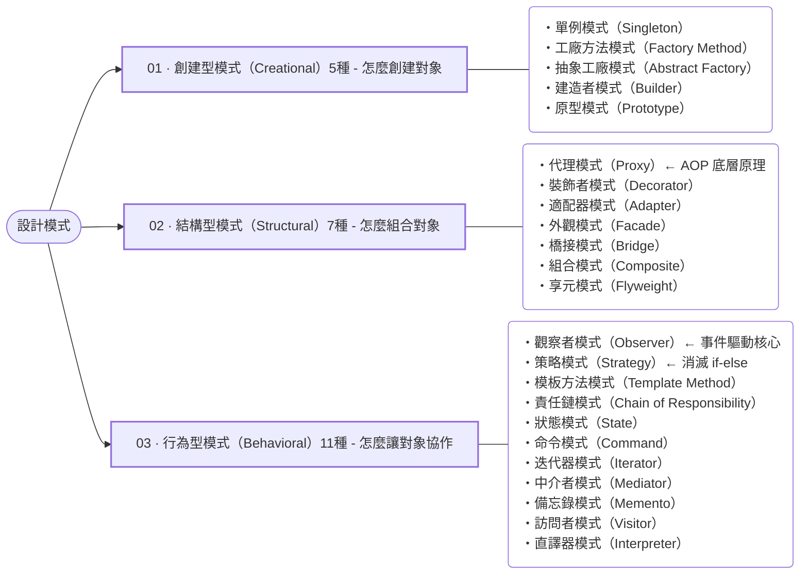
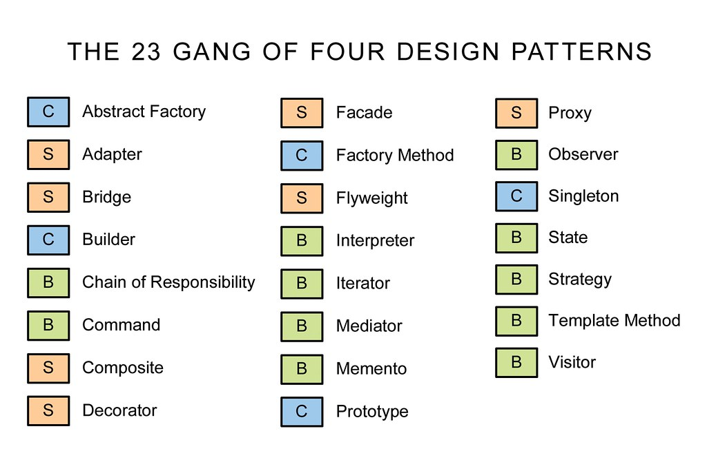

# 設計模式

六大設計原則與 GoF 23 種設計模式，每個模式都搭配 Java 範例與在 Spring 中的實際應用。

**核心技術**：GoF 23 種 / SOLID 原則 / Spring 中的應用

## 學習地圖

## 章節導覽

-   __[01 · 設計模式六大原則](principles.md)__

    ---

    設計模式是手段，設計原則才是目的。

-   __[02 · 創建型模式](creational.md)__

    ---

    創建型模式把「怎麼建立物件」與「怎麼使用物件」分開，讓系統不依賴具體類別。

-   __[03 · 結構型模式](structural.md)__

    ---

    結構型模式處理「類別與物件如何組合成更大的結構」。

-   __[04 · 行為型模式](behavioral.md)__

    ---

    行為型模式關注「物件之間如何分工與溝通」。

## 重點速覽

### 創建型（5 種）

| 模式 | 核心思想 | Spring 應用 |
|------|---------|------------|
| **單例** | 只有一個實例 | Spring Bean（預設 Singleton）|
| **工廠方法** | 子類決定創建哪個類 | BeanFactory，消滅 if-else |
| **抽象工廠** | 創建一系列相關對象 | 跨平台/跨資料庫場景 |
| **建造者** | 分步驟創建複雜對象 | Lombok @Builder / ResponseEntity |
| **原型** | 克隆現有對象 | BeanUtils.copyProperties |

### 結構型（7 種）

| 模式 | 核心思想 | Spring 應用 |
|------|---------|------------|
| **代理** ⭐ | 為對象添加額外功能 | AOP / @Transactional / @Cacheable |
| **裝飾者** | 動態添加功能 | IO 流 / BeanWrapper |
| **適配器** | 讓不兼容介面協同 | HandlerAdapter / 第三方 SDK |
| **外觀** | 簡化複雜子系統介面 | JdbcTemplate / RestTemplate |
| **橋接** | 抽象與實作分離 | 避免繼承爆炸 |
| **組合** | 樹形結構統一處理 | 菜單樹 / 組織架構 |
| **享元** | 共享細粒度對象 | Integer 緩存池 / 資料庫連線池 |

### 行為型（11 種）

| 模式 | 核心思想 | Spring 應用 |
|------|---------|------------|
| **觀察者** ⭐ | 一對多事件通知 | ApplicationEvent / MQ |
| **策略** ⭐ | 算法族可互換 | 消滅 if-else，工廠 + Map 路由 |
| **模板方法** | 定義算法骨架 | JdbcTemplate / AbstractApplicationContext |
| **責任鏈** | 請求沿鏈傳遞 | Filter Chain / Security Filter Chain |
| **狀態** | 不同狀態不同行為 | 訂單狀態機 |
| **命令** | 請求封裝成對象 | 撤銷/重做 / Spring Batch |
| **迭代器** | 統一遍歷集合 | Iterator / Stream / 分頁迭代器 |
| **中介者** | 集中管理交互 | ApplicationEventPublisher / MQ |
| **備忘錄** | 捕獲與恢復狀態 | 草稿自動保存 |
| **訪問者** | 不修改類就加新操作 | 跨類型操作（報表/稅率）|
| **直譯器** | 定義語言文法 | SpEL / 正則表達式 |

## GoF 23 種設計模式一覽

## 核心要點總結

### 創建型（5種）
| 模式 | 核心思想 | 解決問題 | Spring 應用 |
|------|---------|---------|------------|
| **單例** | 只有一個實例 | 全局共享資源 | Spring Bean |
| **工廠方法** | 子類決定創建哪個類 | 消滅 if-else 創建邏輯 | BeanFactory |
| **抽象工廠** | 創建一系列相關對象 | 跨平台/跨資料庫 | — |
| **建造者** | 分步驟創建複雜對象 | 構造器參數爆炸 | @Builder、ResponseEntity |
| **原型** | 克隆現有對象 | 避免重複初始化開銷 | BeanUtils.copyProperties |

### 結構型（7種）
| 模式 | 核心思想 | 解決問題 | Spring 應用 |
|------|---------|---------|------------|
| **代理** | 為對象添加額外功能 | AOP（日誌/事務/權限）| @Transactional、AOP |
| **裝飾者** | 動態添加功能 | 比繼承更靈活 | BeanWrapper、IO 流 |
| **適配器** | 讓不兼容介面協同 | 整合第三方 SDK | HandlerAdapter |
| **外觀** | 為複雜系統提供簡單介面 | 降低客戶端複雜度 | JdbcTemplate |
| **橋接** | 抽象與實作分離 | 避免繼承爆炸 | — |
| **組合** | 樹形結構統一處理 | 遞迴結構（菜單/組織）| — |
| **享元** | 共享細粒度對象 | 節省大量記憶體 | 連線池、Integer 緩存 |

### 行為型（11種）
| 模式 | 核心思想 | 解決問題 | Spring 應用 |
|------|---------|---------|------------|
| **觀察者** | 一對多事件通知 | 解耦發布與消費 | ApplicationEvent |
| **策略** | 算法族可互換 | 消滅 if-else 業務邏輯 | Resource 策略 |
| **模板方法** | 定義算法骨架 | 複用固定流程 | JdbcTemplate |
| **責任鏈** | 請求沿鏈傳遞 | 審核流程、過濾鏈 | Filter Chain |
| **狀態** | 不同狀態不同行為 | 消滅複雜狀態判斷 | 訂單狀態機 |
| **命令** | 請求封裝成對象 | 撤銷/重做/隊列 | Spring Batch、Runnable |
| **迭代器** | 統一遍歷集合 | 不暴露內部結構 | Iterator、Stream |
| **中介者** | 集中管理交互 | 降低對象間耦合 | ApplicationEventPublisher、MQ |
| **備忘錄** | 捕獲與恢復狀態 | 撤銷操作、自動保存 | — |
| **訪問者** | 不修改類就加新操作 | 操作與結構分離 | — |
| **直譯器** | 定義語言文法 | 解析表達式/規則 | SpEL、正則表達式 |
