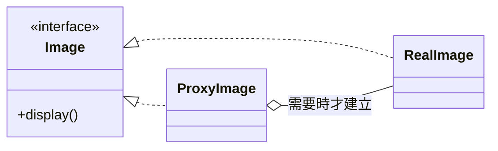
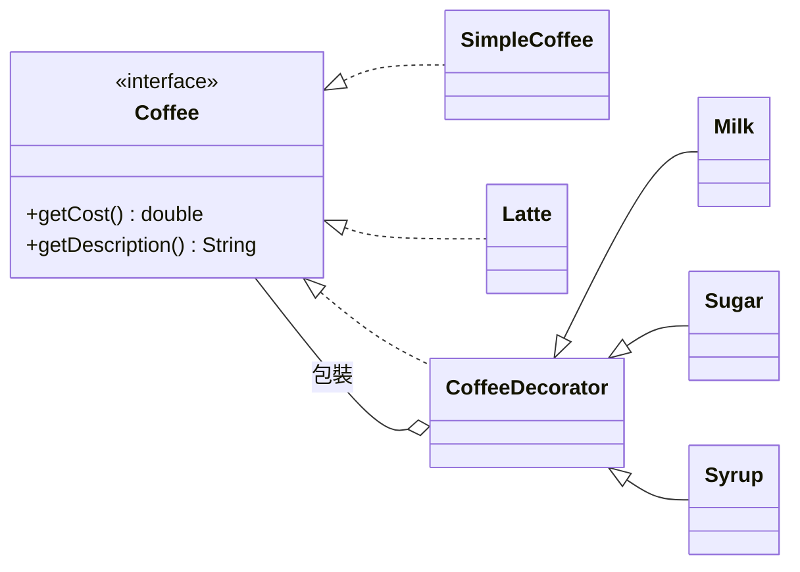
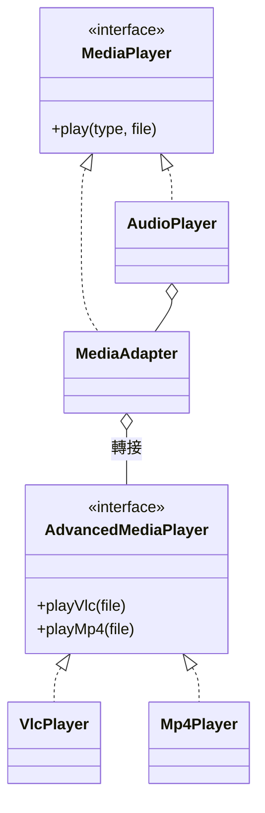
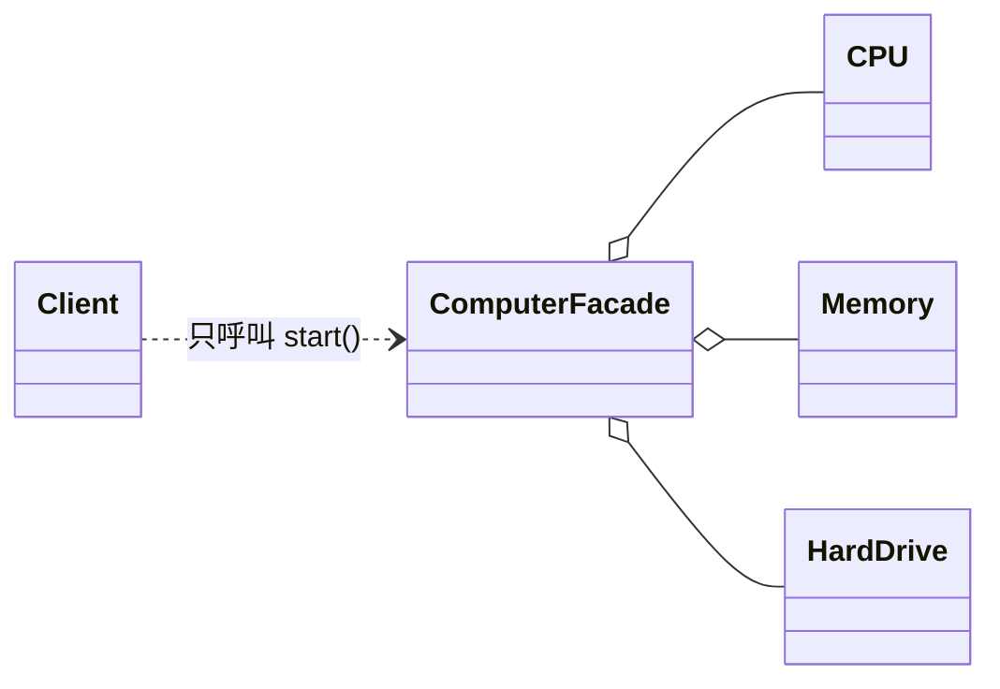
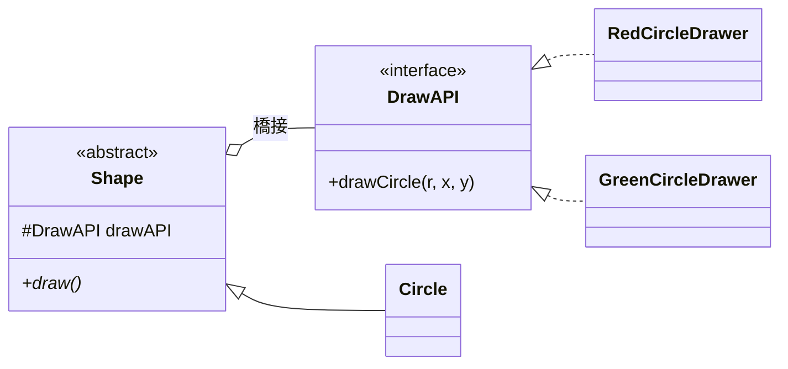
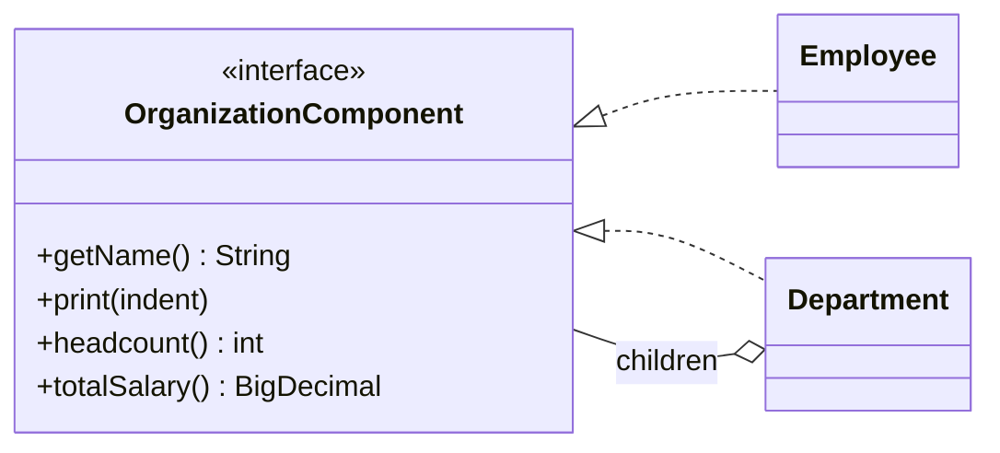
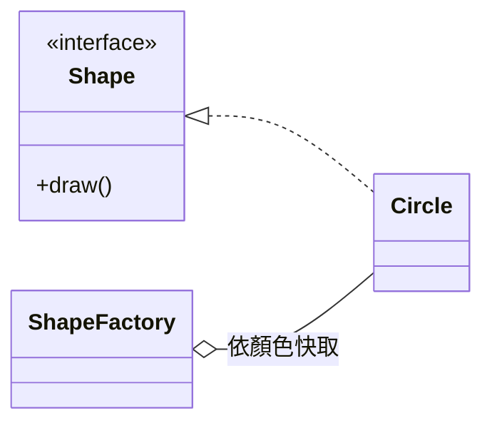

# 結構型模式

!!! abstract "本章重點"

    結構型模式處理「類別與物件如何組合成更大的結構」。本章的 7 種模式中，代理是 Spring AOP 的底層原理，裝飾者是 Java IO 的設計基礎，適配器則是整合第三方 SDK 的標準做法。

## 代理模式（Proxy） — AOP 底層原理

**目的**：在不修改原始類的情況下，為其添加額外功能（日誌、事務、權限等）

**結構**



AnthonyFu-Learning 的範例是**虛擬代理（延遲載入）**：真正的圖片在第一次 `display()` 時才載入。代理的種類還有保護代理（權限控制）、遠端代理（RPC 客戶端），以及 Spring AOP 使用的**動態代理**。

**範例**

=== "AnthonyFu-Learning 範例"

    ``` java
    // ── Image.java ──
    interface Image {
        void display();
    }

    // ── RealImage.java ──
    class RealImage implements Image {
        private String filename;

        public RealImage(String filename) {
            this.filename = filename;
            loadImageFromDisk();
        }

        private void loadImageFromDisk() {
            System.out.println("Loading image: " + filename);
        }

        @Override
        public void display() {
            System.out.println("Displaying image: " + filename);
        }
    }

    // ── ProxyImage.java ──
    class ProxyImage implements Image {
        private RealImage realImage;
        private String filename;

        public ProxyImage(String filename) {
            this.filename = filename;
        }

        @Override
        public void display() {
            // 懶加載 - 僅在需要時創建真實對象
            if (realImage == null) {
                realImage = new RealImage(filename);
            }
            realImage.display();
        }
    }

    // ── ProxyPattern.java ──
    public class ProxyPattern {
        public static void main(String[] args) {
            // 代理模式：用於需要控制對資源的訪問的情況，如遠程代理（遠程訪問對象）、虛擬代理（延遲實例化）、保護代理（權限控制）等。
            // 代理模式為其他對象提供一種代理，以控制對這個對象的訪問。
            // 使用代理加載和顯示圖像
            Image image = new ProxyImage("sample.jpg");

            // 首次調用會加載圖像
            System.out.println("First time display:");
            image.display();

            // 再次調用不會重新加載
            System.out.println("\nSecond time display:");
            image.display();
        }
    }
    ```

=== "原筆記：JDK 動態代理、CGLIB 與 Spring AOP"

    ```java
    // 代理模式三種實作方式：
    // 靜態代理、JDK 動態代理、CGLIB 動態代理

    // ── 方式一：靜態代理 ──
    // 目標介面
    public interface OrderService {
        Order createOrder(OrderRequest request);
    }

    // 真實實作
    public class OrderServiceImpl implements OrderService {
        @Override
        public Order createOrder(OrderRequest request) {
            // 業務邏輯
            return new Order();
        }
    }

    // 靜態代理（手動寫）
    public class OrderServiceProxy implements OrderService {
        private final OrderService target;  // 被代理的真實對象

        public OrderServiceProxy(OrderService target) {
            this.target = target;
        }

        @Override
        public Order createOrder(OrderRequest request) {
            // 前置處理（如：記錄日誌）
            long start = System.currentTimeMillis();
            log.info("開始創建訂單，userId={}", request.getUserId());

            try {
                Order order = target.createOrder(request); // 調用真實方法

                // 後置處理（如：發送通知）
                log.info("訂單創建成功，orderId={}", order.getId());
                return order;

            } catch (Exception e) {
                log.error("訂單創建失敗", e);
                throw e;
            } finally {
                log.info("耗時：{} ms", System.currentTimeMillis() - start);
            }
        }
    }

    // 缺點：每個介面都要寫一個代理類，工程量大
    ```

    ```java
    // ── 方式二：JDK 動態代理 ──
    // 只能代理有介面的類（基於介面）

    public class JdkProxyFactory {

        public static <T> T createProxy(T target) {
            return (T) Proxy.newProxyInstance(
                target.getClass().getClassLoader(),   // 類加載器
                target.getClass().getInterfaces(),    // 代理哪些介面
                new LoggingInvocationHandler(target)  // InvocationHandler
            );
        }
    }

    public class LoggingInvocationHandler implements InvocationHandler {
        private final Object target;

        public LoggingInvocationHandler(Object target) {
            this.target = target;
        }

        @Override
        public Object invoke(Object proxy, Method method, Object[] args)
                throws Throwable {
            // 所有方法調用都會經過這裡！
            log.info("調用方法：{}，參數：{}", method.getName(), Arrays.toString(args));
            long start = System.currentTimeMillis();

            try {
                Object result = method.invoke(target, args);  // 反射調用真實方法
                log.info("方法 {} 執行成功，耗時：{} ms",
                    method.getName(), System.currentTimeMillis() - start);
                return result;

            } catch (InvocationTargetException e) {
                log.error("方法 {} 執行失敗", method.getName(), e.getCause());
                throw e.getCause();
            }
        }
    }

    // 使用
    OrderService realService = new OrderServiceImpl();
    OrderService proxy       = JdkProxyFactory.createProxy(realService);
    proxy.createOrder(request);  // 自動觸發 InvocationHandler.invoke()
    ```

    ```java
    // ── 方式三：CGLIB 動態代理 ──
    // 可以代理沒有介面的類（基於繼承，生成子類）

    // 目標類（沒有介面）
    public class UserService {
        public User getUser(Long id) {
            return userRepository.findById(id).orElseThrow();
        }
    }

    // CGLIB 代理
    public class CglibProxyFactory implements MethodInterceptor {

        public Object createProxy(Class<?> targetClass) {
            Enhancer enhancer = new Enhancer();
            enhancer.setSuperclass(targetClass);    // 設定父類（繼承目標類）
            enhancer.setCallback(this);             // 設定攔截器
            return enhancer.create();               // 創建代理對象（子類）
        }

        @Override
        public Object intercept(Object obj, Method method,
                                Object[] args, MethodProxy proxy)
                throws Throwable {
            log.info("CGLIB 代理攔截：{}", method.getName());
            Object result = proxy.invokeSuper(obj, args);  // 調用父類（真實）方法
            log.info("CGLIB 代理完成：{}", method.getName());
            return result;
        }
    }

    // ⚠️ CGLIB 注意事項：
    // final 類不能被代理（無法繼承）
    // final 方法不能被攔截
    // 需要無參構造器（或顯式指定構造器參數）
    ```

    **JDK 動態代理 vs CGLIB**

    | | JDK 動態代理 | CGLIB |
    |---|-------------|-------|
    | 代理方式 | 基於介面 | 基於繼承（子類） |
    | 目標要求 | 必須實作介面 | 可以是普通類 |
    | 效能（創建） | 慢（反射） | 稍慢（位元組碼生成） |
    | 效能（調用） | 慢（反射 invoke） | 快（直接調用子類方法） |
    | final 類 | 不支援 | 不支援 |
    | Spring 使用 | 有介面時預設使用 | 無介面時使用 |

    **Spring AOP 底層**

    ``` mermaid
    flowchart LR
        CALLER["調用方"] --> PROXY["Spring 代理物件"]
        PROXY -->|"@Transactional<br>開啟 / 提交 / 回滾事務"| TARGET["目標方法"]
        PROXY -->|"@Cacheable<br>先查緩存"| TARGET
        PROXY -->|"@PreAuthorize<br>執行前檢查權限"| TARGET
    ```

    ```java
    // Spring AOP 完整範例
    @Aspect
    @Component
    @Slf4j
    public class PerformanceAspect {

        // 切點：所有 Service 類的所有方法
        @Pointcut("execution(* com.example.service.*.*(..))")
        public void serviceMethod() {}

        // 環繞通知
        @Around("serviceMethod()")
        public Object aroundServiceMethod(ProceedingJoinPoint joinPoint)
                throws Throwable {

            String className  = joinPoint.getTarget().getClass().getSimpleName();
            String methodName = joinPoint.getSignature().getName();
            Object[] args     = joinPoint.getArgs();

            log.info("[{}] {}, 參數: {}",
                className, methodName, Arrays.toString(args));

            long start = System.currentTimeMillis();

            try {
                Object result = joinPoint.proceed();  // 執行真實方法

                long duration = System.currentTimeMillis() - start;
                log.info("[{}] {} 執行成功，耗時: {} ms", className, methodName, duration);

                // 慢方法告警
                if (duration > 1000) {
                    log.warn("[慢方法告警] [{}] {} 耗時 {} ms！",
                        className, methodName, duration);
                }

                return result;

            } catch (Exception e) {
                log.error("[{}] {} 執行失敗: {}", className, methodName, e.getMessage());
                throw e;
            }
        }

        // 前置通知
        @Before("@annotation(preAuthorize)")
        public void checkPermission(JoinPoint joinPoint, PreAuthorize preAuthorize) {
            // 方法執行前檢查權限
        }

        // 後置通知（成功才執行）
        @AfterReturning(pointcut = "serviceMethod()", returning = "result")
        public void afterReturning(Object result) {
            // 方法成功返回後執行
        }

        // 異常通知
        @AfterThrowing(pointcut = "serviceMethod()", throwing = "exception")
        public void afterThrowing(Exception exception) {
            log.error("方法拋出異常：{}", exception.getMessage());
        }
    }
    ```

**在 Spring 與實務中**：`@Transactional`、`@Cacheable`、`@Async` 都靠動態代理實作；OpenFeign 的介面也是在執行期產生代理物件。

## 裝飾者模式（Decorator）

**目的**：動態地為對象添加功能，比繼承更靈活

**結構**



裝飾者與代理的結構幾乎一樣，差別在**目的**：代理是「控制存取」，呼叫端通常不知道有代理；裝飾者是「疊加功能」，呼叫端主動一層一層包裝（`new Milk(new Sugar(new Latte()))`）。

**範例**

``` java
// ── Coffee.java ──
public interface Coffee {
    double getCost();
    String getDescription();
}

// ── SimpleCoffee.java ──
class SimpleCoffee implements Coffee {
    @Override
    public String getDescription() {
        return "Simple Coffee";
    }

    @Override
    public double getCost() {
        return 2.0;
    }
}

// ── CoffeeDecorator.java ──
public abstract class CoffeeDecorator implements Coffee {
    protected Coffee decoratedCoffee;

    public CoffeeDecorator(Coffee coffee) {
        this.decoratedCoffee = coffee;
    }

    public double getCost() {
        return decoratedCoffee.getCost();
    }

    public String getDescription() {
        return decoratedCoffee.getDescription();
    }
}

// ── DecoratorPattern.java ──
public class DecoratorPattern {
    public static void main(String[] args) {
        // 裝飾器模式：用於需要動態地添加功能，而且這些功能可以組合使用的情況，如 Java IO 類庫。
        // 裝飾器模式允許動態地給對象添加新功能，不改變其結構。
        // 點一杯Latte，添加Milk和Sugar、Syrup
        Coffee latte = new Milk(new Sugar (new Syrup(new Latte())));
        System.out.println("Cost: " + latte.getCost() + ", Description: " + latte.getDescription());

        // 創建一個簡單咖啡
        Coffee simpleCoffee = new SimpleCoffee();
        System.out.println("Cost: $" + simpleCoffee.getCost() + ", Description: " + simpleCoffee.getDescription());

        // 添加牛奶
        Coffee milkCoffee = new MilkDecorator(simpleCoffee);
        System.out.println("Cost: $" + milkCoffee.getCost() + ", Description: " + milkCoffee.getDescription());

        // 添加糖
        Coffee sweetMilkCoffee = new SugarDecorator(milkCoffee);
        System.out.println("Cost: $" + sweetMilkCoffee.getCost() + ", Description: " + sweetMilkCoffee.getDescription());
    }
}
```

??? example "其餘實作類別"

    ``` java
    // ── Latte.java ──
    public class Latte implements Coffee {
        @Override
        public double getCost() {
            return 2.99;
        }

        @Override
        public String getDescription() {
            return "Latte";
        }
    }

    // ── Milk.java ──
    public class Milk extends CoffeeDecorator {
        public Milk(Coffee coffee) {
            super(coffee);
        }

        public double getCost() {
            return super.getCost() + 0.5;
        }

        public String getDescription() {
            return super.getDescription() + ", Milk";
        }
    }

    // ── Sugar.java ──
    public class Sugar extends CoffeeDecorator {
        public Sugar(Coffee decoratedCoffee) {
            super(decoratedCoffee);
        }

        public double getCost() {
            return super.getCost() + 0.2;
        }

        public String getDescription() {
            return super.getDescription() + ", Sugar";
        }
    }

    // ── Syrup.java ──
    public class Syrup extends CoffeeDecorator {
        public Syrup(Coffee coffee) {
            super(coffee);
        }

        public double getCost() {
            return super.getCost() + 0.25;
        }

        public String getDescription() {
            return super.getDescription() + ", Syrup";
        }
    }
    ```

**在 Spring 與實務中**：Java IO（`new BufferedReader(new InputStreamReader(in))`）、`HttpServletRequestWrapper`、Spring Session 包裝 `HttpSession`。

## 適配器模式（Adapter）

**目的**：讓介面不兼容的類可以一起工作

**結構**



**範例**

=== "AnthonyFu-Learning 範例"

    ``` java
    // ── MediaPlayer.java ──
    interface MediaPlayer {
        void play(String audioType, String filename);
    }

    // ── AdvancedMediaPlayer.java ──
    interface AdvancedMediaPlayer {
        void playVlc(String filename);
        void playMp4(String filename);
    }

    // ── VlcPlayer.java ──
    class VlcPlayer implements AdvancedMediaPlayer {
        @Override
        public void playVlc(String filename) {
            System.out.println("Playing vlc file: " + filename);
        }

        @Override
        public void playMp4(String filename) {
            // 不做任何事
        }
    }

    // ── Mp4Player.java ──
    class Mp4Player implements AdvancedMediaPlayer {
        @Override
        public void playVlc(String filename) {
            // 不做任何事
        }

        @Override
        public void playMp4(String filename) {
            System.out.println("Playing mp4 file: " + filename);
        }
    }

    // ── AdapterPattern.java ──
    public class AdapterPattern {
        public static void main(String[] args) {
            // 適配器模式：用於使不兼容的接口能夠協同工作，如連接舊系統與新系統，或集成第三方庫。
            // 適配器模式使得原本由於接口不兼容而無法一起工作的類能夠協同工作。
            AudioPlayer audioPlayer = new AudioPlayer();

            audioPlayer.play("mp3", "song.mp3");
            audioPlayer.play("mp4", "movie.mp4");
            audioPlayer.play("vlc", "video.vlc");
            audioPlayer.play("avi", "video.avi"); // 不支持的格式
        }
    }
    ```

    ??? example "其餘實作類別"

        ``` java
        // ── MediaAdapter.java ──
        class MediaAdapter implements MediaPlayer {
            private AdvancedMediaPlayer advancedMediaPlayer;

            public MediaAdapter(String audioType) {
                if (audioType.equalsIgnoreCase("vlc")) {
                    advancedMediaPlayer = new VlcPlayer();
                } else if (audioType.equalsIgnoreCase("mp4")) {
                    advancedMediaPlayer = new Mp4Player();
                }
            }

            @Override
            public void play(String audioType, String filename) {
                if (audioType.equalsIgnoreCase("vlc")) {
                    advancedMediaPlayer.playVlc(filename);
                } else if (audioType.equalsIgnoreCase("mp4")) {
                    advancedMediaPlayer.playMp4(filename);
                }
            }
        }

        // ── AudioPlayer.java ──
        class AudioPlayer implements MediaPlayer {
            private MediaAdapter mediaAdapter;

            @Override
            public void play(String audioType, String filename) {
                // 原生支持播放 mp3 格式
                if (audioType.equalsIgnoreCase("mp3")) {
                    System.out.println("Playing mp3 file: " + filename);
                }
                // 通過適配器支持其他格式
                else if (audioType.equalsIgnoreCase("vlc") || audioType.equalsIgnoreCase("mp4")) {
                    mediaAdapter = new MediaAdapter(audioType);
                    mediaAdapter.play(audioType, filename);
                } else {
                    System.out.println("Invalid media. " + audioType + " format not supported");
                }
            }
        }
        ```

=== "原筆記：整合第三方支付 SDK"

    ```java
    // 場景：第三方支付 SDK 的介面和我們系統的介面不兼容

    // 1. 我們系統的支付介面（目標介面）
    public interface PaymentGateway {
        boolean pay(String orderId, BigDecimal amount, String currency);
    }

    // 2. 第三方 SDK（被適配者，介面不同，無法修改）
    public class AlipaySDK {
        public String createPayment(String merchantOrderId, double amount) {
            // 支付寶 SDK 的邏輯
            return "SUCCESS";
        }
    }

    public class StripeSDK {
        public StripeResponse charge(StripeRequest request) {
            // Stripe SDK 的邏輯
            return new StripeResponse("succeeded");
        }
    }

    // 3. 適配器（讓不兼容的介面協同工作）
    @Component
    public class AlipayAdapter implements PaymentGateway {

        private final AlipaySDK alipaySDK = new AlipaySDK();

        @Override
        public boolean pay(String orderId, BigDecimal amount, String currency) {
            // 適配：將我們的介面轉換為 SDK 的介面
            String result = alipaySDK.createPayment(
                orderId,
                amount.doubleValue()  // BigDecimal → double
            );
            return "SUCCESS".equals(result);
        }
    }

    @Component
    public class StripeAdapter implements PaymentGateway {

        private final StripeSDK stripeSDK = new StripeSDK();

        @Override
        public boolean pay(String orderId, BigDecimal amount, String currency) {
            StripeRequest request = new StripeRequest();
            request.setAmount(amount.multiply(new BigDecimal("100")).longValue()); // 元 → 分
            request.setCurrency(currency.toLowerCase());
            request.setMetadata(Map.of("orderId", orderId));

            StripeResponse response = stripeSDK.charge(request);
            return "succeeded".equals(response.getStatus());
        }
    }

    // 4. 使用（客戶端只依賴 PaymentGateway 介面）
    @Service
    public class OrderService {
        // 不關心具體是哪個支付方式
        @Autowired
        @Qualifier("alipayAdapter")
        private PaymentGateway paymentGateway;

        public void pay(Order order) {
            boolean success = paymentGateway.pay(
                order.getId().toString(),
                order.getAmount(),
                "CNY"
            );
        }
    }
    ```

**在 Spring 與實務中**：`HandlerAdapter` 讓 DispatcherServlet 用同一種方式呼叫各種 Controller；實務上最常用在**包裝第三方 SDK**，讓業務程式只依賴自己定義的介面。

## 外觀模式（Facade）

**目的**：為複雜的子系統提供一個簡單的介面

**結構**



呼叫端只需要 `computer.start()`，不需要知道 CPU、記憶體、硬碟的啟動順序。業務系統中常見的是 `OrderFacade`：把庫存、價格、付款、物流、通知包成一個「下單」方法。

**範例**

``` java
// ── CPU.java ──
class CPU {
    public void freeze() {
        System.out.println("CPU: Freezing...");
    }
    public void jump(long position) {
        System.out.println("CPU: Jumping to position " + position);
    }
    public void execute() {
        System.out.println("CPU: Executing instructions...");
    }
}

// ── Memory.java ──
class Memory {
    public void load(long position, String data) {
        System.out.println("Memory: Loading from position " + position + " data: " + data);
    }
}

// ── HardDrive.java ──
class HardDrive {
    public String read(long lba, int size) {
        System.out.println("HardDrive: Reading data from sector " + lba + " with size " + size);
        return "Data from hard drive";
    }
}

// ── ComputerFacade.java ──
class ComputerFacade {
    private CPU processor;
    private Memory ram;
    private HardDrive hardDrive;

    public ComputerFacade() {
        this.processor = new CPU();
        this.ram = new Memory();
        this.hardDrive = new HardDrive();
    }

    public void start() {
        processor.freeze();
        ram.load(0, hardDrive.read(0, 1024));
        processor.jump(0);
        processor.execute();
    }
}

// ── FacadePattern.java ──
public class FacadePattern {
    public static void main(String[] args) {
        // 外觀模式：用於簡化複雜子系統的使用，提供一個統一的接口。
        // 外觀模式提供了一個統一的接口，用來訪問子系統中的一組接口，簡化了客戶端與複雜系統的交互。
        ComputerFacade computer = new ComputerFacade();
        computer.start();
    }
}
```

**在 Spring 與實務中**：`JdbcTemplate`、`RestTemplate` 把繁瑣的底層 API 包成簡單的方法；SLF4J 是各種日誌框架的外觀。

## 橋接模式（Bridge）

**目的**：將抽象與實作分離，兩者可以獨立變化（避免繼承爆炸）

**結構**



「形狀」與「繪製方式」是兩個獨立變化的維度。用繼承會變成 `RedCircle`、`GreenCircle`、`RedSquare`… 數量相乘；用橋接則是 形狀數 + 繪製方式數。業務上的例子：訊息類型（一般 / 緊急）× 發送管道（Email / SMS / 推播）。

**範例**

``` java
// ── DrawAPI.java ──
interface DrawAPI {
    void drawCircle(int radius, int x, int y);
}

// ── RedCircleDrawer.java ──
class RedCircleDrawer implements DrawAPI {
    @Override
    public void drawCircle(int radius, int x, int y) {
        System.out.println("Drawing Circle[ color: red, radius: " + radius + ", x: " + x + ", y: " + y + "]");
    }
}

// ── GreenCircleDrawer.java ──
class GreenCircleDrawer implements DrawAPI {
    @Override
    public void drawCircle(int radius, int x, int y) {
        System.out.println("Drawing Circle[ color: green, radius: " + radius + ", x: " + x + ", y: " + y + "]");
    }
}

// ── Shape.java ──
abstract class Shape {
    protected DrawAPI drawAPI;

    protected Shape(DrawAPI drawAPI) {
        this.drawAPI = drawAPI;
    }

    public abstract void draw();
}

// ── Circle.java ──
class Circle extends Shape {
    private int x, y, radius;

    public Circle(int x, int y, int radius, DrawAPI drawAPI) {
        super(drawAPI);
        this.x = x;
        this.y = y;
        this.radius = radius;
    }

    @Override
    public void draw() {
        drawAPI.drawCircle(radius, x, y);
    }
}

// ── BridgePattern.java ──
public class BridgePattern {
    public static void main(String[] args) {
        // 橋接模式：用於將抽象與實現分離，使它們可以獨立變化，適用於多維度變化的系統。
        // 橋接模式用於將抽象部分與實現部分分離，使它們可以獨立變化。
        // 使用紅色圈繪製器創建圓形
        Shape redCircle = new Circle(100, 100, 10, new RedCircleDrawer());
        // 使用綠色圈繪製器創建圓形
        Shape greenCircle = new Circle(200, 200, 20, new GreenCircleDrawer());

        redCircle.draw();
        greenCircle.draw();
    }
}
```

**在 Spring 與實務中**：JDBC：`DriverManager` 與各家資料庫的 `Driver` 實作分離；SLF4J 的 API 與綁定的實作分離。

## 組合模式（Composite）

**目的**：將對象組合成樹形結構，讓客戶端對單個對象和組合對象統一處理

**結構**



**範例**

```java
// 場景：公司組織架構（部門可以包含子部門和員工）

// 1. 統一介面（Component）
public interface OrganizationComponent {
    String getName();
    void print(String indent);
    int headcount();  // 人數
    BigDecimal totalSalary();  // 總薪資
}

// 2. 葉節點（Leaf）- 員工
@Data
@AllArgsConstructor
public class Employee implements OrganizationComponent {
    private String     name;
    private String     position;
    private BigDecimal salary;

    @Override
    public void print(String indent) {
        System.out.println(indent + "👤 " + name + "（" + position + "）");
    }

    @Override public int headcount()         { return 1; }
    @Override public BigDecimal totalSalary() { return salary; }
}

// 3. 組合節點（Composite）- 部門
public class Department implements OrganizationComponent {
    private final String name;
    private final List<OrganizationComponent> children = new ArrayList<>();

    public Department(String name) { this.name = name; }

    // 管理子節點
    public void add(OrganizationComponent component) {
        children.add(component);
    }
    public void remove(OrganizationComponent component) {
        children.remove(component);
    }

    @Override
    public String getName() { return name; }

    @Override
    public void print(String indent) {
        System.out.println(indent + "🏢 " + name);
        // 遞迴打印所有子節點
        children.forEach(child -> child.print(indent + "  "));
    }

    // 遞迴計算：無論層級多深，調用方式完全相同！
    @Override
    public int headcount() {
        return children.stream().mapToInt(OrganizationComponent::headcount).sum();
    }

    @Override
    public BigDecimal totalSalary() {
        return children.stream()
            .map(OrganizationComponent::totalSalary)
            .reduce(BigDecimal.ZERO, BigDecimal::add);
    }
}

// 4. 使用
public class Main {
    public static void main(String[] args) {
        // 建立組織架構
        Department company = new Department("科技公司");

        Department engineering = new Department("工程部");
        engineering.add(new Employee("Alice", "後端工程師", new BigDecimal("80000")));
        engineering.add(new Employee("Bob",   "前端工程師", new BigDecimal("75000")));

        Department backend = new Department("後端組");
        backend.add(new Employee("Charlie", "資深工程師", new BigDecimal("100000")));
        backend.add(new Employee("Dave",    "工程師",     new BigDecimal("70000")));
        engineering.add(backend);  // 部門嵌套部門

        Department hr = new Department("人資部");
        hr.add(new Employee("Eve", "HR 主管", new BigDecimal("60000")));

        company.add(engineering);
        company.add(hr);

        // 客戶端調用方式完全相同，不管是部門還是員工！
        company.print("");
        System.out.println("總人數：" + company.headcount());
        System.out.println("總薪資：" + company.totalSalary());
    }
}
// 輸出：
// 🏢 科技公司
//   🏢 工程部
//     👤 Alice（後端工程師）
//     👤 Bob（前端工程師）
//     🏢 後端組
//       👤 Charlie（資深工程師）
//       👤 Dave（工程師）
//   🏢 人資部
//     👤 Eve（HR 主管）
// 總人數：5
```

**在 Spring 與實務中**：選單樹、組織架構、檔案目錄；Spring 的 `CompositeCacheManager`、`CompositePropertySource` 把多個實作組合成一個。

## 享元模式（Flyweight）

**目的**：透過共享技術，複用大量細粒度對象，節省記憶體

**結構**



**內部狀態**（顏色）可以共用，放在享元物件裡；**外部狀態**（座標、半徑）每次使用時由呼叫端傳入。同一種顏色的圓只建立一次。

**範例**

``` java
// ── Shape.java ──
interface Shape {
    void draw();
}

// ── Circle.java ──
class Circle implements Shape {
    private String color;
    private int x;
    private int y;
    private int radius;

    public Circle(String color) {
        this.color = color;
    }

    public void setX(int x) {
        this.x = x;
    }

    public void setY(int y) {
        this.y = y;
    }

    public void setRadius(int radius) {
        this.radius = radius;
    }

    @Override
    public void draw() {
        System.out.println("Circle: Draw() [Color: " + color + ", x: " + x + ", y: " + y + ", radius: " + radius + "]");
    }
}

// ── FlyweightPattern.java ──
public class FlyweightPattern {
    private static final String[] colors = { "Red", "Green", "Blue", "Yellow", "Black" };

    public static void main(String[] args) {
        // 享元模式 / 輕量模式：用於大量相似對象的高效共享，如字體渲染、遊戲中的粒子效果等。
        // 享元模式 / 輕量模式用於減少創建對象的數量，以減少內存佔用和提高性能。
        // 使用工廠獲取共享對象
        for (int i = 0; i < 20; ++i) {
            Circle circle = (Circle)ShapeFactory.getCircle(getRandomColor());
            circle.setX(getRandomX());
            circle.setY(getRandomY());
            circle.setRadius(100);
            circle.draw();
        }
    }

    private static String getRandomColor() {
        return colors[(int)(Math.random() * colors.length)];
    }

    private static int getRandomX() {
        return (int)(Math.random() * 100);
    }

    private static int getRandomY() {
        return (int)(Math.random() * 100);
    }
}
```

??? example "其餘實作類別"

    ``` java
    // ── ShapeFactory.java ──
    class ShapeFactory {
        private static final Map<String, Shape> circleMap = new HashMap<>();

        public static Shape getCircle(String color) {
            Circle circle = (Circle)circleMap.get(color);

            if (circle == null) {
                circle = new Circle(color);
                circleMap.put(color, circle);
                System.out.println("Creating circle of color: " + color);
            }
            return circle;
        }
    }
    ```

**在 Spring 與實務中**：`Integer.valueOf()` 快取 -128 \~ 127、字串常數池、資料庫連線池與執行緒池（物件池是享元思想的延伸）。
