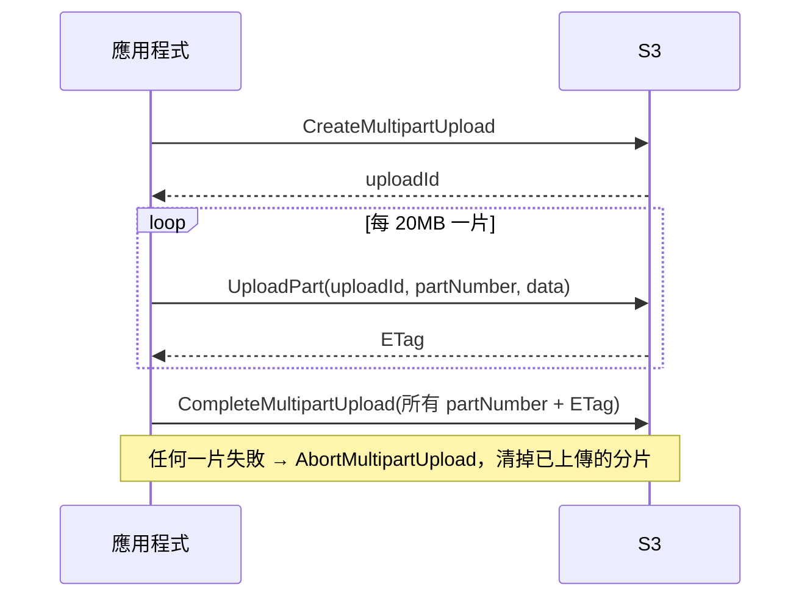

# 儲存與資料庫：S3、RDS、ElastiCache

!!! abstract "本章重點"

    本章介紹 S3 的特性與儲存類別，並以 holidayDessert 的 Multipart Upload 說明大檔案上傳的正確做法；接著說明 RDS / Aurora 的 Multi-AZ 與 Read Replica、ElastiCache 的叢集模式。

## S3：物件儲存

S3 不是檔案系統，而是 **Key → Object** 的扁平儲存。`uploads/2026/11/cake.jpg` 裡的 `/` 只是 Key 的一部分。

| 特性 | 說明 |
|------|------|
| 耐久性 | 11 個 9（99.999999999%），資料自動複製到多個 AZ |
| 單一物件上限 | 5TB；單次 PUT 上限 5GB，更大的檔案必須用 **Multipart Upload** |
| 一致性 | 寫入後立即可讀（強一致） |
| 預設安全 | **Block Public Access** 預設開啟，不要關；對外分享改用 Pre-signed URL 或 CloudFront |

**儲存類別**

| 類別 | 適合 | 取回 |
|------|------|------|
| Standard | 經常存取 | 即時 |
| Intelligent-Tiering | 存取模式不確定 | 即時，自動搬移省錢 |
| Standard-IA | 不常存取但要立刻拿到 | 即時，有取回費 |
| Glacier Instant / Flexible / Deep Archive | 備份、稽核資料 | 毫秒到 12 小時 |

用 **Lifecycle 規則**自動搬移：30 天後轉 IA、180 天後轉 Glacier、未完成的 Multipart Upload 7 天後自動清除。

## 我的實作：Multipart Upload 邊讀邊傳

!!! abstract "專案：holidayDessert"

    AWS SDK v2 + `S3Client`。檔案大於 20MB 時改用分片上傳，**邊讀邊傳**，記憶體中只需保留一個分片；查看檔案時用 Pre-signed URL 產生有時效的下載連結。



``` java
private static final long MULTIPART_CHUNK_SIZE = 20L * 1024 * 1024;

private void putObjectMultipart(String bucket, String key, InputStream in, long fileSize, String contentType) throws IOException {
    String uploadId = createMultipartUpload(bucket, key, contentType);
    List<CompletedPart> completedParts = new ArrayList<>();
    try {
        long remaining = fileSize;
        int partNumber = 1;
        while (remaining > 0) {
            int chunkSize = (int) Math.min(MULTIPART_CHUNK_SIZE, remaining);
            byte[] buffer = new byte[chunkSize];
            int bytesRead = in.readNBytes(buffer, 0, chunkSize);        // 一次只讀一片進記憶體
            if (bytesRead <= 0) break;
            UploadPartResponse resp = s3Client.uploadPart(
                    UploadPartRequest.builder().bucket(bucket).key(key)
                            .uploadId(uploadId).partNumber(partNumber).build(),
                    RequestBody.fromBytes(bytesRead == chunkSize ? buffer : Arrays.copyOf(buffer, bytesRead)));
            completedParts.add(CompletedPart.builder().partNumber(partNumber).eTag(resp.eTag()).build());
            remaining -= bytesRead;
            partNumber++;
        }
        completeMultipartUpload(bucket, key, uploadId, completedParts);
    } catch (Exception e) {
        abortMultipartUpload(bucket, key, uploadId);   // 不 Abort 的話，殘留分片會一直計費
        throw e;
    }
}
```

| 設計 | 原因 |
|------|------|
| 分片大小 20MB | S3 規定除了最後一片，每片至少 5MB、最多 10,000 片 |
| 邊讀邊傳 | 上傳 2GB 檔案也只佔約 20MB 記憶體 |
| 失敗時 Abort | 未完成的分片看不到、卻會計費 |
| Pre-signed URL | Bucket 保持私有，前端拿到有時效的連結直接下載，不經過應用程式 |

!!! tip "可以再優化的地方"

    - **前端直傳**：後端只發 Pre-signed URL（每片一個），瀏覽器直接上傳到 S3，大檔案完全不經過應用程式伺服器
    - **並行上傳分片**：`S3AsyncClient` 或 `S3TransferManager` 可同時上傳多片，速度更快
    - 憑證改用 IAM Role，不要用 `AwsBasicCredentials` 寫在設定檔（見[基礎架構](foundation.md)）

## RDS / Aurora：託管關聯式資料庫

| 功能 | 說明 |
|------|------|
| **Multi-AZ** | 同步複製到另一個 AZ 的備援，故障時自動切換（約 1 \~ 2 分鐘），**用於高可用** |
| **Read Replica** | 非同步複製的唯讀副本，**用於讀寫分離**（對應 [主從複製](../../data/mysql/replication.md)） |
| 自動備份 | 每日快照 + 交易日誌，可還原到保留期內的任意時間點 |
| **Aurora** | AWS 自研，相容 MySQL / PostgreSQL；儲存層跨 3 AZ 6 份副本、最多 15 個讀副本 |
| RDS Proxy | 連線池，避免 Lambda 等大量短連線打爆資料庫 |

!!! warning "Multi-AZ ≠ Read Replica"

    Multi-AZ 的備援**不能讀**，只是待命；要分散讀取壓力必須另外建 Read Replica。

## ElastiCache：託管 Redis

- 支援 Redis OSS / Valkey、Memcached
- **Cluster Mode**：資料分片到多個 Shard，對應 [Redis Cluster](../../data/redis/cluster.md)
- Multi-AZ 自動故障轉移；也有 Serverless 版本
- 搶票系統的 Lua Script、分散式鎖都可以直接搬上去（Cluster Mode 下 Lua 的多個 Key 必須在同一個 Slot，用 `{typeId}` Hash Tag 確保）

## 其他常見服務

| 服務 | 用途 |
|------|------|
| **DynamoDB** | Serverless NoSQL Key-Value，毫秒級延遲、自動擴展 |
| **SQS / SNS** | 託管佇列 / 發布訂閱，對應 RabbitMQ 的部分功能 |
| **MSK** | 託管 Kafka |
| **OpenSearch Service** | 託管 OpenSearch，holidayDessert 用的就是 OpenSearch |
| **EFS** | 多台機器可同時掛載的 NFS 檔案系統 |
